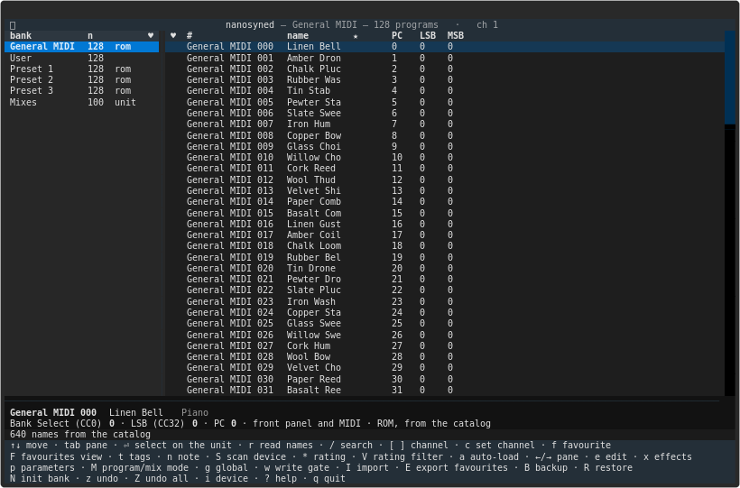
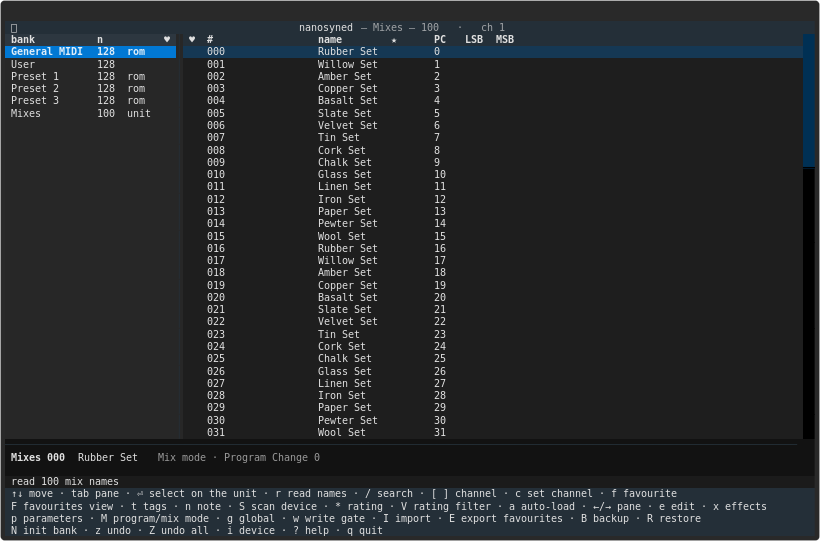
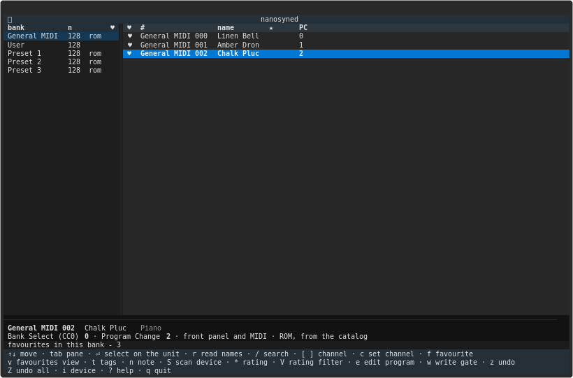
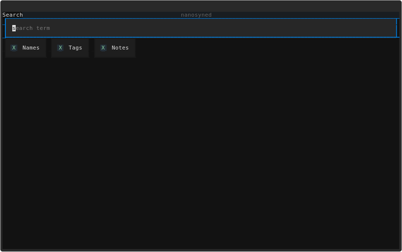
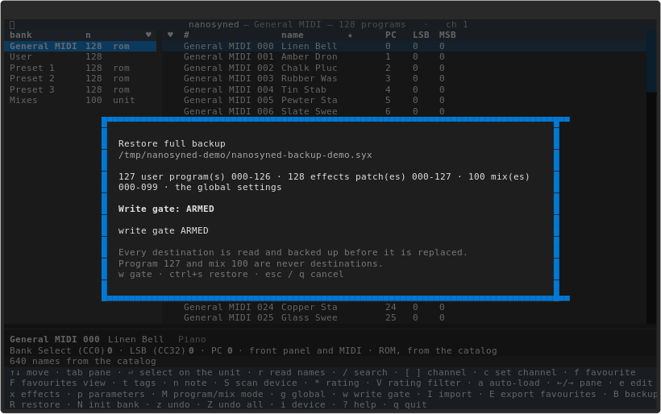
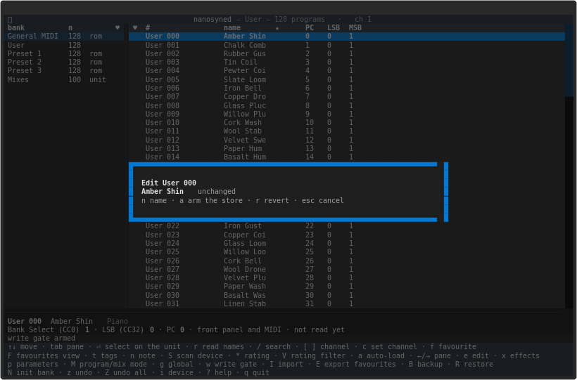
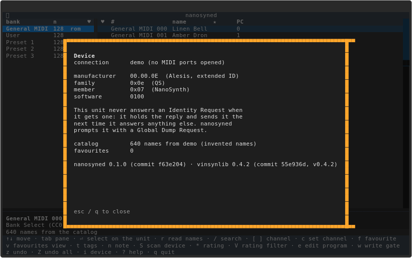
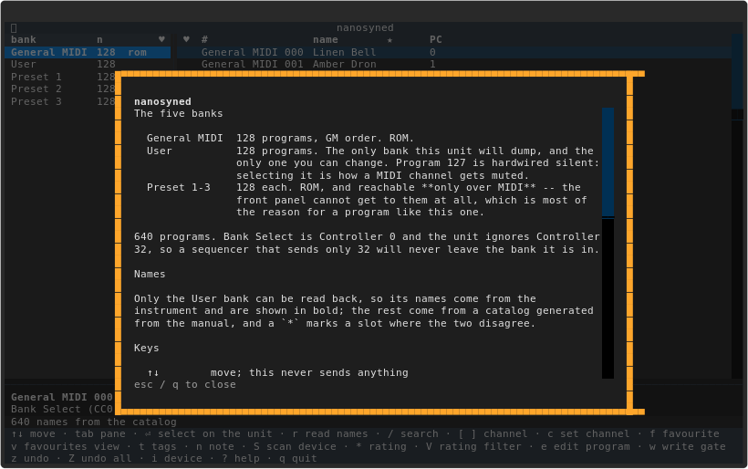
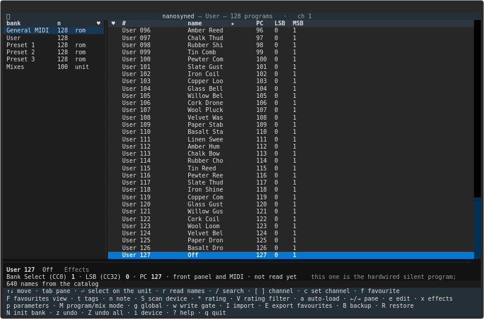
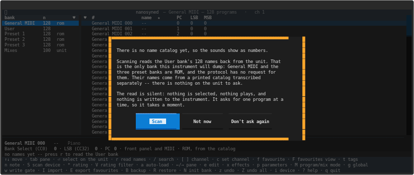

<!-- SPDX-License-Identifier: GPL-2.0-or-later -->
<!-- SPDX-FileCopyrightText: Copyright (C) 2026  nanosyned contributors -->

# nanosyned

A terminal browser, editor and verified SysEx backup/restore tool for the
**Alesis NanoSynth** — the 640 programs, the ones the front panel cannot
reach, and the names the unit will tell you.

Sibling to [rxved](https://github.com/lentferj/rxved) (Roland XV-2020),
kwsed (Korg Wavestation SR), [p2ked](https://github.com/lentferj/p2ked)
(E-MU Proteus 2000) and x5ded (Korg X5D/X5DR), and it follows their
conventions.

## Support this project

nanosyned is free software and always will be. Nothing is behind a paywall, no
feature is withheld, and none of what follows changes that.

But if it has been useful — if it saved you an evening of mapping zones
by hand, or got a library onto a machine that had no way of reading it, or
**best of all, if it has your vintage instrument switched on and in use more often
than it was, and you are having more fun with it** — then please consider
supporting the work.

**Because here is what it has actually cost:**

- **Real machines on a real bench.** Much of what these tools know about these
  formats was measured on hardware rather than read anywhere, because for most
  of it there is nowhere to read it. That needs the machines — the instruments
  themselves — and it puts hours of wear on hardware that has been locked up and
  recovered more than once in the course of it. Some of these instruments were
  bought specifically to add and verify a format; the others were already here,
  because the person doing this is a vintage instrument enthusiast first and the
  projects exist because the instruments were in the room.
- **Dozens — realistically hundreds — of hours of human time.** Format
  reverse-engineering is slow: measure, be wrong, measure again. A single
  parameter law in this README can represent an evening at the bench.
- **AI assistance, which is a paid service**, used heavily throughout and not
  cheap at this volume.

**This is support, not a donation — and the distinction is a legal one, not a
turn of phrase.** The maintainer is based in Germany, where payments like these
are *not* `Spenden` in the tax sense: they count as **taxable income** for the
recipient and are **not tax-deductible** for the giver. So this section is
titled *Support*, deliberately, and no receipt for tax purposes can be issued.
(That is a statement of how it is handled here, not tax advice.)

If the project saved you the work, you can support it through
**[GitHub Sponsors](https://github.com/sponsors/lentferj)** — the *Sponsor*
button at the top of the repository. Payment is handled entirely by GitHub and
Stripe, so bank and tax details are never handed to the person paying.

**Support is not expected, and it is not the only currency.**

- **Bug reports** — ideally with the bank, preset or disk image that produced
  them. A tool's failures are usually specific to one file rather than
  general, and without that file they are very hard to reproduce.
- **Confirmations from hardware that is not on this bench**, which matters more
  here than for a single-machine tool. These tools write for whole *families*
  of instruments, and the bench holds only a subset. Whether a variant accepts
  what we write is genuinely unknown, and several notes say "on this unit" for
  that reason. A "loads fine here too", or a "no, mine refuses it", is worth a
  great deal.
- **Corrections to the reverse-engineering notes.** The wrong turns are
  recorded next to the findings in `docs/RESOLUTION_NOTES.md` — retractions
  included, because a finding that was withdrawn is as useful as one that
  stood. If any of it is wrong in a way that is still costing someone time,
  saying so improves the record.

---

## AI assistance & human authorship

nanosyned was built by its human author together with AI assistance. The
**ideas, the project vision, and every feature** came from the human author;
AI assisted with **writing the code and analyzing the binary formats**.
Crucially, the **reverse engineering rests on hands-on human work** — all testing
and verification on real hardware, creating the reference images/banks on those
instruments (disk saves, SysEx probes), and aural A/B comparison of presets —
which is what makes the results correct.
Full account in [DISCLAIMER.md](DISCLAIMER.md).

---
## ⚠️ Use at your own risk — back up first

**nanosyned** is provided **as is, with absolutely no warranty and no liability**
for data loss or **hardware damage**. You assume all risk. Full terms:
[DISCLAIMER.md](DISCLAIMER.md).

Before you use this software, **make good, current backups of all your files** —
and of any existing banks on your instrument and storage media. These tools can
write to hardware and storage media; a mistake, a bug, or untested output could
overwrite or corrupt data, or be rejected by hardware. Always test on a spare
unit or emulator **before** connecting irreplaceable equipment.

---

## Why

The NanoSynth has 640 programs and a front panel with three knobs and no
display. **384 of those programs cannot be reached from the panel at
all** — the manual says so plainly — and the unit has no way to tell you
what any of them are called. nanosyned selects them by Bank Select and
Program Change, reads back the names of the one bank that can be read,
and keeps your favourites.



## What it knows, and how it knows it

The NanoSynth's Reference Manual has one line about System Exclusive, in
its implementation chart, and no specification. What the unit actually
speaks is the **Alesis QS protocol** — it is a QS engine in a small box —
and that is published. Everything in `nano/messages.py` is transcribed
from Alesis's QS6/7/8/R specification and was then confirmed against the
instrument. Where the two disagreed, the instrument won and
`docs/RESOLUTION_NOTES.md` says so.

The unit reports itself as QS family member **7**. Alesis's published list
covers QS6, QS7, QS8 and QSR and stops; 7 appears to be recorded nowhere
else.

## The five program banks

| bank | CC 0 | front panel | can be read back |
|------|------|-------------|------------------|
| General MIDI | 0 | yes | no |
| User | 1 | yes | **yes** |
| Preset 1 | 2 | no | no |
| Preset 2 | 3 | no | no |
| Preset 3 | 4 | no | no |

Only the User bank has a dump request. The other four are ROM, so their
names come from a catalog you generate locally; the User bank's come from
the instrument, and the browser marks which is which.

**Bank Select is Controller 0.** The unit ignores Controller 32, which
many sequencers send instead.

## Mixes

The left pane has a sixth row, **Mixes**, below the five program banks. The
right pane lists mixes `000`–`099`, with names read from the unit the first
time the row is opened. Selecting a mix with `⏎` sends **Mode Select: Mix
mode**, then loads the stored mix into the unit's live mix buffer through
the mix-edit-buffer number `100`; no Program Change or Bank Select is sent.
Selecting a program while the app last sent Mix mode sends Program mode first.

The unit has no request that reports its current mode, so the mode is tracked
best-effort from what this app sent; it is not a reading. The currently
playing mix is likewise not readable, so the picker does not claim to show
one. `e` on a focused mix opens its editor; `M` still sends a manual Mode
Select. Mix edits are **live**: each change loads the edited mix into buffer
`100`, so it is audible before it is stored. `⏎`/`space` toggle switches, the
program field opens the five-bank program browser, and the field shows the
bank, program number and program name together. `a` then `s` stores the
result. The QS record's `program_type` field is the program bank code
(0=GM, 1=User, 2-4=Preset 1-3), despite the specification printing its
range as 0-1. Codes 5-15 are card banks on a full QS; this unit has no
card slots, and they resolve to GM, shown as “GM (fallback)”.

`C` copies the focused mix to another slot. It copies the whole 138-byte
record, so the name, all sixteen parts and the common settings move
together. The destination is asked for by number and then confirmed because
the copy overwrites it; the old destination is backed up and the write is
logged for `z`, exactly as an editor store is. The source is not changed.

In the mix program browser, `F` cycles the same three views as the main
browser (all programs, the current bank's favourites, every favourite).
Pressing a letter jumps to the first name starting with it; pressing the
same letter again moves to the next match and wraps to the top.



## Install

```sh
python3 -m venv .venv
.venv/bin/pip install -e .
source .venv/bin/activate
```

Needs Python 3.11+, `python-rtmidi` and `textual`, plus **vinsynlib** — the
shared base of this family of terminal instrument tools: the settings cache,
the keymap and legend, the command line and the port listing. It comes from
PyPI with the rest. To develop against a *working copy* of it instead of the
published one, install that alongside — it shadows the published version in
this environment only: `.venv/bin/pip install --no-deps -e ../vinsynlib`.

## Running it

The install puts two commands on `PATH` — `nanosyned` for the browser and
`nanocli` for the command line — or run the modules from a checkout:

```
nanosyned --demo                   # a NanoSynth that is not there
nanosyned                          # find the real one
nanocli banks                      # the five banks
nanocli read                       # the User bank's names (silent)
nanocli syx FILE                   # read a .syx dump, no hardware
```

`--demo` opens no MIDI port and constructs no bridge, so it is safe to run
beside a session that is driving the hardware.

## The browser

| key | |
|---|---|
| `↑↓` | move the cursor — silent unless auto-load is on |
| `⏎` | select this slot **on the unit** — it will sound |
| `tab` / `←` / `→` | switch pane (banks ↔ slots) |
| `a` | auto-load the focused preset: send PC/LSB/MSB when the cursor moves |
| `S` | scan the unit: read the User bank's names, with progress, cancellable |
| `r` | read the User bank's names again (silent) |
| `/` | search names, tags and notes |
| `[` / `]` / `c` | previous / next send channel, or type one |
| `f` | favourite this slot |
| `F` | cycle the view: all slots → this bank's favourites → every favourite |
| `t` / `n` / `*` | tags / note / rating, 0–5 stars (on a favourite) |
| `V` | filter by rating — exactly that many, or that many and up |
| `e` | edit the focused program, or the focused mix in Mixes — **only while the gate is armed** |
| `C` | copy the focused mix to another slot — gate, destination prompt and overwrite confirmation |
| `x` | edit effects patch 000 |
| `p` | verified parameter editor: Global / Mix / Program rows |
| `M` | set the sound mode, Program or Mix — **a write, and it changes what plays** |
| `g` | edit the global record |
| `I` | import programs from a `.syx` / `.sqs` file |
| `E` | export favourited User programs to a `.syx` file |
| `B` | full backup: read the whole unit into one `.syx` file — silent, no gate |
| `R` | restore a full backup from a `.syx` file — armed gate, two confirmations, backup/verify/one undo |
| `N` | initialise the User bank: replace 000-126 with the unit's Init program; 127 Off untouched; backup/verify/one undo |
| `w` | arm / lock the write gate |
| `z` / `Z` | undo / undo all — put back what a store replaced |
| `i` / `?` / `q` | device identity / help / quit |

The cursor is silent until `a` turns auto-load on; after that, moving the slot
cursor sends the focused preset's PC/LSB/MSB. `⏎` is always the explicit
one-key select, and every write key is inert until `w` has armed the gate — see
[Writing to the instrument](#writing-to-the-instrument) for the whole fence.
`x` edits the effects record through the same store fence; `p` opens the
parameter editor, which moves the working copy but does not store it.

  
  

## Command line

`nanocli` is the same operations one at a time. Everything is read-only
except `select`, which is marked, and the write commands, which are gated:

```
nanocli ports                      # MIDI ports (opens nothing)
nanocli banks                      # the five banks, and what each allows
nanocli list USER                  # every slot in a bank, with known names
nanocli status                     # ask the unit who it is (silent)
nanocli current                    # what the unit is playing (silent)
nanocli read                       # the User bank's names (silent)
nanocli mixes                      # the mix names (silent)
nanocli dump program 12 --file p.syx   # one record off the unit, as .syx
nanocli dump global --file g.syx       # the global settings, the same way
nanocli dump favourites --file favs.syx # read the active favourite slots;
                                    #   --force replaces an existing file
nanocli select USER 12             # select it ON THE UNIT — plays; asks first
nanocli syx FILE                   # read a .syx file (no hardware)
nanocli find "bass"                # search known names (no hardware)
nanocli fav                        # the favourites database (no hardware)
nanocli tags                       # tags in use, with counts (no hardware)

nanocli send FILE --allow-write --yes
                                   # WRITE a .syx into the unit: reads and
                                   #   backs up every destination, verifies
nanocli set program 8 0 0 42 --allow-write --yes
                                   # write one parameter (MIDI Edit; the
                                   #   working copy moves, nothing is stored)
nanocli backup save --file PATH     # silent, read-only FULL backup of the
                                    #   whole unit to one .syx; --force
                                    #   replaces an existing file; no gate,
                                    #   no --allow-write / --yes
nanocli backup list                 # JSON undo envelopes on disk (no unit needed)
nanocli backup restore FILE --allow-write --yes
                                    # write one JSON envelope back — DESTRUCTIVE
nanocli init-bank --allow-write --yes
                                    # initialise User bank 000-126 with Init; 127 untouched
nanocli init-bank --dry-run
                                    # show the plan; send nothing
nanocli import FILE --append --allow-write --yes
                                    # append source programs to free trailing slots
nanocli import FILE --append --cut --allow-write --yes
                                    # ...overflow: load what fits, drop the rest
nanocli import FILE --append --dry-run
                                    # show the assignments and cuts; send nothing
```

Global options go **before** the subcommand — `nanocli --demo banks` — and
mean the same here as in the browser: `--port` names one port and asks
nothing, `--scan` probes every port, `--demo` opens none. `--favorites`,
`--preset-memory`, `--yes` and `--allow-write` also work *after* the
subcommand, which is the shape people type.

`ports`, `banks`, `list`, `syx`, `find`, `fav`, `tags` and `backup list`
construct no bridge and open no port — they work on a headless box and while
somebody else is using the hardware. `select` asks before it plays unless
`--yes`. Every write invocation — `send`, `set`, `import`, `init-bank` and
`backup restore` — refuses to run without **both** `--allow-write` and
`--yes`, and the check happens before a port is opened, so a refusal costs
nothing. Each names what it is about to replace — by the name the unit
holds — backs it up, sends, and reads it back.

`nanocli fav USER 12 --add --rate 4 --tags "bass" --note "for the intro"`
favourites that slot; `--remove` un-favourites it, `--rate` alone rates one
you already have, and `--tag` / `--search` / `--rating-at-least` / `--order`
filter the listing. `favorites` is an alias.

## The name catalog

`nano/data/catalog.json` is **gitignored**. Alesis's program names are
Alesis's work and this project does not redistribute them. Generate it
from your own material:

```
python3 tools/extract_catalog.py --syx my-own-dump.syx          # User bank
python3 tools/extract_catalog.py --pdf                          # the manual
python3 tools/extract_catalog.py --manual my-transcription.txt  # any bank
```

**The preset names are in the manual.** The
`Alesis Nanosynth Reference Manual.PDF` carries the full program list —
all 640 names for all five banks — under *"NanoSynth Program List"*,
starting on **page 30** and running to page 33. Those pages' fonts are
subsetted with no to-Unicode map, so the text layer is mojibake and the
pages have to be read as images:

```
python3 tools/extract_catalog.py --pdf --draft draft.txt
```

`--pdf` renders those four pages and reads them with OCR (it needs
`pdftoppm` from poppler-utils and `tesseract` on `PATH`; set
`NANOSYNED_TESSERACT` if tesseract lives somewhere else, and
`NANOSYNED_MANUAL` or pass a path if the PDF is elsewhere). **OCR makes
mistakes** — a trailing footnote number, a `—` read for a `–` — so
`--draft draft.txt` writes the result as a `BANK NNN Name` list to
proofread and feed back through `--manual`. Only the User bank can be read
from the instrument itself; the other four banks' names come from here.

A dump beats the page: give both and the User bank's names come from the
unit, the rest from the manual.

```
python3 tools/extract_catalog.py --pdf --syx my-own-dump.syx
```

nanosyned runs without it.

## Memory / live names

Names read off the unit are kept in a sidecar beside the catalog —
`live-names.json`, next to `catalog.json` in `nano/data/` by default — and
they survive a restart. The browser loads them at startup, so it shows the
right names *before* anything has talked to the unit; the next read confirms
them and saves them back, so the following start is right again without one.
Point the browser at another catalog (`--catalog`) and the sidecar travels
with it, because the names were read against that catalog's bank layout.

The sidecar is deliberately **not** inside the catalog file. The catalog is
a transcription of the manual; the sidecar is one instrument's current
contents, and the printed-versus-live disagreement is the whole point of
having two sources — the browser marks which name came from where, and
overwriting one with the other would destroy that. A missing sidecar means
nothing has been read yet; a corrupt one earns a warning rather than a
refusal to open, because names are a convenience.

## Backups

Every write is preceded by an unconditional backup: the destination is read
in full and that read is written to a file **before** a byte goes out, and if
the read fails, nothing is written — a write that cannot be undone is not
performed.

The files live in nanosyned's per-platform settings directory, with
`backups/` beneath it — beside `config.toml`, and **not** in the checkout,
which `git clean` empties. Each backup is one record's blocks base64-encoded
in the family's JSON envelope, version-checked before it is trusted; the
kinds are `program`, `mix`, `effects` and `global`. A filename never
overwrites one already there, so the restore points accumulate. `nanocli
backup list` shows them newest first, and a backup that cannot be read is
listed with its error rather than dropped — a restore point you cannot read
is exactly the thing to be told about.

### Full backups

The per-write envelopes above protect a single destination. A **full backup**
captures the whole unit in one file: press `B` in the browser, or run
`nanocli backup save --file FILE`. The browser prompts for a path and
defaults to `nanosyned-backup-YYYYMMDD-HHMMSS.syx` in the remembered import
folder (or the home directory); the CLI writes the file it is given, with
`--force` to replace an existing one.

It is one ordinary Alesis `.syx` — the same kind of file `nanocli send`
takes — not the JSON envelope used for pre-write backups. It holds **356
messages / 79,071 bytes**: user programs 000-126 (127 programs; 127 is
hardwired silent and excluded), user effects 000-127 (128), user mixes
000-099 (100; 100 is the non-stored edit buffer and excluded), and the one
global settings record.

All 356 destinations are read first, and only then is the file written
atomically — to `path + ".tmp"`, fsynced, then `os.replace`d into place. A
failed or cancelled read leaves no file behind, and a partial file never
appears. Individual record reads are used rather than the All Dump request,
so a failure names the destination it stopped on. Because it only reads the
unit, a full backup is silent: no write gate, no `--allow-write` / `--yes`.

Restore it with the browser's `R`, choose the `.syx`, arm the write gate
and confirm twice, or use the normal send path: `nanocli send FILE
--allow-write --yes` reads and backs up every destination, stores, and
verifies. A browser restore is one undo entry spanning all four record
kinds. (A full backup is a plain `.syx`, not a pre-write JSON envelope, so
`nanocli backup restore` is not the tool for it — that command remains for
the envelopes. Likewise `nanocli backup list` still lists only the pre-write
JSON envelopes in the settings `backups/` directory; a full `.syx` is
wherever you wrote it.)



## Writing to the instrument

Writing here is destructive and **unacknowledged**: the unit answers a store
with silence whether it took it or not. So the fence exists, and it is the
family's arm-then-fire shape, not a suggestion:

- **The gate decides, and sends nothing.** `w` arms it (or `--allow-write`
  at launch); while it is locked, the write keys are inert and a refusal
  names the gate. The check happens on the main thread before a worker
  exists, so a refused action sends no message at all — not a store, not a
  read, nothing.
- **Back up first, unconditionally.** The destination is read in full before
  a byte is written, and that read is the backup.
- **Say what is about to be destroyed, by name.** "Program 12" means
  nothing; the name it is about to replace means everything.
- **Verify by reading back, and name what did not match.** The store is
  compared byte for byte against what the unit holds afterwards, because
  silence cannot be taken for success. Only an agreed read-back is recorded
  for undo, so `z` can never "restore" a write the unit refused.

**User program 127 is hardwired silent** and cannot be changed; the editor,
`nanocli send` and `nanocli backup restore` all refuse it outright.

What can be written: a User program's name (the editor sends the whole
350-byte record; the sound blocks travel through untouched), an effects
patch, a mix's sixteen channels, and the global record — whole-record stores
behind `w` — plus
single parameters through the MIDI Edit message (`nanocli set`), which moves
the unit's working copy and is not stored, and the Program/Mix sound mode
(`M`, the `0D` Mode Select), which changes what the unit plays. The store
opcodes are the QS specification's — `00` program, `06` effects, `0E` mix,
`0A` global, `10` parameter edit, `0D` mode select — transcribed from it and
confirmed against the instrument on the read side;
`docs/RESOLUTION_NOTES.md` records which is which.

The parameter tables behind these editors are transcribed from Alesis's
published QS specification. **75 of the 178 rows have been confirmed on the
unit** by a controlled before/after probe (10 Global, 27 Mix, 38 Program, 0
Effects); the rest are still transcriptions, and the editors must treat them
as read-only. The multi-value pass found that on 13 signed rows the spec's
Limit sits one past the unit's top, so those rows carry the measured top
(99/12/24) and were re-probed there before promotion. A row becomes writable
only after that probe confirms its offset and its value law, and the
findings -- including the mix and program rows that did not confirm, and the
Effects mode the unit ignores -- are in
`docs/PARAMETER_VERIFICATION_RUN_LOG.md`. The `.sqs` container is read by
`nano/sqs.py`; its scanning rules are in `docs/RESOLUTION_NOTES.md` §21.
`.mid` and `.lib` remain out of scope.

  

## Importing programs

`nanocli import` reads a `.syx` (one bank of 128) or `.sqs` (Alesis factory
banks) file and sends each record to a chosen User slot, backing up and
verifying each one. In the browser, `I` opens the file picker.

```
nanocli --demo --allow-write --yes import FILE --program 0=5
                                       # one source program -> User slot 5
nanocli --demo --allow-write --yes import FILE --all
                                       # every program in the source -> the
                                       #   same User slot, in order
nanocli --demo --allow-write --yes import FILE --all --effects --mixes --global
                                       # also import effects, mixes and global
nanocli --demo import FILE --program 0=5 --dry-run
                                       # show the plan; send nothing
```

The browser: `I` opens the file picker, then asks **Whole bank**, **Append
to free slots**, or **Single / multiple programs**. The whole-bank path
writes each source program to its own slot; the mapping screen lets you
assign source programs to chosen User slots, and `ctrl+s` there imports the
mapping you built. The browser imports programs only; effects, mixes and
global are the CLI's `--all` extras, or a full restore with `R`. The write
gate must be armed; a locked gate refuses the import with no message sent.

Source 127 is hardwired silent and is skipped on bank import; destination
127 is refused as a destination everywhere. Mix slot 100 is the edit
buffer's own slot and is never stored. Every store is backed up, read back,
and compared byte for byte; only an agreed read-back is recorded for undo,
so `z` restores a whole import as one entry, and a partial failure keeps a
reduced entry for the slots that did not come back.

### Appending imports

**Append to free slots** writes the source programs into free User slots
without replacing existing programs. A free slot is a trailing slot holding
the Init template (a byte-identical Init record); append never overwrites a
non-Init preset. It scans backwards from slot 126 and appends only after the
highest non-Init slot, so earlier gaps are left for the single/multiple
picker rather than filled. If the file needs more slots than are free, the
screen names the cut programs and offers two choices: `ctrl+s` loads what fits
and cuts the rest, or `s` switches to single/multiple programs. With no free
slots at all, `ctrl+s` refuses and points to `N` (init bank) or the
single/multiple picker. Append is programs only: effects, mixes and global
records in the file are ignored. The CLI equivalents are
`nanocli import FILE --append` (with `--cut` to load what fits) and
`--dry-run`.

### Initialising the User bank

`N` initialises the User bank: it replaces User programs `000`-`126` with the
unit's Init program. User `127` (`Off`) is hardwired silent and is never
written. Every replaced slot is read, backed up, stored and read back through
the normal fence, and one `z` restores the whole batch. Favourite marks on the
replaced slots are hidden; the old content and its annotations stay in the
preset memory and return if those bytes are loaded again. The Init template
is the unit's own hardwired `Off` record from slot `127` with only its name
changed to `Init`; no parameter byte is invented. The template candidate passed a data
write/read-back check on the bench and was confirmed silent; the scratch
slot was then restored byte-for-byte. The CLI equivalent is
`nanocli init-bank --allow-write --yes`
(`--dry-run` shows the plan without storing).

## Exporting favourites

`E` in the browser, or `nanocli dump favourites --file PATH`, reads the
active favourite programs from the User bank and writes them to one `.syx`
file. Only programs carrying an active favourite mark in the User bank are
included; slots `000`–`126` are exported in ascending slot order, and slot
`127` (`Off`) is excluded because it cannot be written back. The file uses
the original slot numbers and is a normal `.syx` that `nanocli import` (or
`I` in the browser) can read back, so an export is a faithful snapshot and
a restore.

Every record is read from the unit before the file is written. A failed read
or a cancel therefore leaves no file behind; the file is only created once
all selected slots have been read successfully. The write itself is atomic:
it goes to `path + ".tmp"` in the same directory, is flushed, and then
replaces the destination with `os.replace`, so a half-written file cannot
remain. An existing path is refused unless `--force` is given on the CLI or
the replacement is confirmed in the browser.

Ratings, tags and notes are local favourites data and are **not** in the
`.syx`; the file carries program bytes only. Export only reads the unit, so
it needs no write gate and no `--allow-write` / `--yes`.

## Preset memory

Favourites used to be tied to a slot. The browser now also keeps a
**content-addressed memory**, so a preset loaded into a different slot can
come back as the favourite it was before.

The identity is the **SHA-256 of the full 350-byte program record**. The
name is part of the record, so renaming a preset creates a new identity.
The memory stores the last-seen name, the favourite flag, rating, tags,
note, first/last seen and a seen count, in `preset-memory.db` beside
`favorites.db`. Both files are user data and should be backed up together.
A test or embedder can point the sidecar elsewhere with `--preset-memory`;
the browser, `R` restore, `nanocli import`, `nanocli send` and
`nanocli init-bank` use the same file.

`favorites.db` still decides which slots currently show a heart. The
sidecar decides whether those bytes were favourited before. On a verified
import or send, the app hashes the record, remembers it, and restores the
heart and annotations if the content was a favourite. A non-favourite
import over a previously favourited slot clears that slot's mark; the old
content stays in the memory, so loading it again brings its heart back.
Toggling `f` on a slot whose content identity is known is content-level:
turning it off clears every bound occurrence of those bytes.

Existing slot favourites migrate lazily: the first time their bytes are
seen, their rating, tags and note are adopted into the memory. There is no
full-bank read at startup. If two old slot rows hash to the same content,
the earliest-added row's annotations win.

The limits are deliberate. The memory identifies a **program record**, not
a complete sound: effects, mixes and global settings are not part of the
hash. It is local to this machine; a file shared with another user does not
carry the annotations. It cannot match a name-insensitive “same sound”
variant, and a changed parameter or name is a new identity. It does not
read the whole User bank at startup. The catalog is not its home: the
catalog is generated name data, while the memory is the user's own work.

## The bench, real hardware

`make test-hardware` drives a real NanoSynth. It is **not** part of `make
check`, and nothing runs it unless you ask: without `--hardware`, every test
in `tests/test_hardware.py` *skips* — a skip with a reason, never a pass, so
"the synth was off" and "the offsets are wrong" cannot look the same. It asks
read-only questions — identity, all 128 User program names, the mix and
global record sizes, the edit buffer — and its one write, a User program
renamed and put back, sits behind a third gate (`NANOSYNED_HW_WRITE=1`) and
restores the original bytes in a `finally` with a read-back assertion, so a
failed check leaves the unit as it found it.

One session at a time: the suite opens MIDI ports, so it never runs beside
another session that is driving the unit. `tools/measure_send_gap.py`
measures the two timing constants (`SEND_GAP`, `SELECT_GAP`) against the
unit — see [Honest limits](#honest-limits). The demo path (`--demo`) is the
synthetic stand-in everywhere else, and a demo agrees with whatever nanosyned
believes, which is why the bench exists.

  
  

## Honest limits

- **`SEND_GAP` is measured at 0.000 on the bench** — no inter-message delay
  is needed; `SELECT_GAP` (0.005 s) **is still a guess** until a probe that
  can observe it exists. `tools/measure_send_gap.py` measures both.
- **Only the User bank can be read.** The other four are ROM and the
  protocol has no request for them, so their names come from a catalog you
  generate from your own transcription. General MIDI is the easy half — the
  bank is in GM order, so a standard name list fits it exactly — and the
  three preset banks are not; those names are yours to type, and they are
  not this project's to redistribute.
- **The parameter tables are only partly bench-verified.** The record sizes
  are pinned on the unit (program 350, mix 138, effects 65, global 20 bytes)
  and one rename has been written, read back and restored on the bench.
  **75 of 178 parameter rows** have been confirmed by a controlled probe;
  the rest in `nano/params.py` are transcriptions, and the editors keep them
  read-only. The global editor shows rows the spec documents for another
  model — and will not write them, because a store writes the whole record
  and reporting success over a value the unit is documented to ignore would
  be a lie.
- **Mixes are decoded, not catalogued.** Their names come off the unit
  (`nanocli mixes`, `e` on a focused Mixes row); the manual never mentions them, and
  they live outside the catalog like every other live read.
- **User 127 is hardwired silent** — the one slot no write can touch, in the
  editor and on the command line alike.

## Screenshots

The frames in this README live in `docs/screenshots/`, each as a `.png` with
its `.svg` source beside it: `browser` (the five banks, Mixes and the slot
pane), `mixes`, `detail` (the row under the cursor), `favourites` (the `F`
views), `search` (`/`), `scan-offer` (the `S` scan), `editor`, `restore`
(the `R` confirmation), `device` (the `i` report) and `help` (`?`). They are
captured from `--demo` with invented names, so no real unit's contents appear
in them.

  
  

## Development checks

No AI is involved in these. Every tool runs locally, offline except for
`pip-audit`, and each one either passes or fails the build.

```sh
make check        # everything below, in order; stops at the first failure
```

| target | what it runs |
|---|---|
| `make lint` | `ruff check` and `ruff format --check` |
| `make format` | `ruff check --fix` and `ruff format` — **the only target that edits your code** |
| `make typecheck` | `mypy` |
| `make test` | `pytest`, with coverage and a `term-missing` report |
| `make test-hardware` | the hardware suite against a real NanoSynth — opens MIDI ports, so **not** part of `check` |
| `make audit` | `pip-audit`, `vulture`, `deptry`, `detect-secrets` |

All configuration lives in `pyproject.toml` (`[tool.ruff]`, `[tool.mypy]`,
`[tool.pytest.ini_options]`, `[tool.coverage]`, `[tool.vulture]`,
`[tool.deptry]`), except `.pre-commit-config.yaml` and `.secrets.baseline`.
The dev toolchain is pinned in `requirements-dev.txt`; `make venv` creates
`.venv` and installs it.

`git commit` runs ruff (lint and format), mypy and detect-secrets through
pre-commit, so the same rules apply whether you use `make` or not. If your
venv lives elsewhere, `make check PY=/usr/bin/python3 BIN=/usr/local/bin`.

**shellcheck and shfmt are not wired up.** The repository contains no shell
scripts — no `*.sh` and no file with a bash/sh shebang — so those hooks would
never fire. Add them to `.pre-commit-config.yaml` alongside a script.

### What is enabled, and what is not

**ruff** — rules `E, F, I, B, S, SIM, UP, C4, PL, RUF, C901`, so it replaces
flake8, isort, black and pyupgrade. Asserts are allowed in `tests/` and
nowhere else. The handful of rules that are off are listed in the next
section.

**mypy** — non-strict, because nothing here was written for it. `nano/banks.py`
and `nano/catalog.py` are fully annotated and are held to the individual checks
`strict` would apply; add a module to that list in `pyproject.toml` once it
qualifies.

**pip-audit** — audits what the project declares: `pyproject.toml`'s runtime
dependencies (rendered to a temp file at run time, so it cannot drift) and
`requirements-dev.txt`. It deliberately does *not* audit the whole
environment: the venv inherits the host's site-packages, which reports
vulnerabilities in unrelated system packages.

**No coverage threshold.** There is one, of zero percent enforced — the point
is the `term-missing` table, so you can see what is untested. A floor should be
a number someone agreed to, not one a tool invented.

### What is switched off, and why

Nothing is baselined: `make check` is clean on the whole tree. The few rules
that are off are off because they disagree with how this codebase is written,
not because the code failed them:

- **`PLR2004`** (magic value in comparison) — this is a MIDI/SysEx codebase
  full of wire bytes; comparing against `0x7F`, `100` or `15` is how the
  format is written down, and naming every one would obscure it.
- **`PLC0415`** (import outside the top level) — the CLI and the TUI defer
  Textual and rtmidi so the offline subcommands and the unit tests do not pay
  for importing a TUI framework.
- **`S110`/`S112`** (try/except/pass and /continue) — best-effort teardown on
  the MIDI path: a `close_port` that raises during cleanup must not mask the
  error that got us there.
- **`SIM105`** — `contextlib.suppress` is not this codebase's idiom; the
  explicit `try`/`except` carries a comment saying why in each case.
- **`S101`** — allowed in `tests/`, where `assert` is what a test is for, and
  nowhere else.
- **`PLR0913`** and **`S608`** in `nano/favorites.py` — `Favorites.add` spells
  out every field because it is the schema; the one SQL string interpolates an
  `ORDER BY` clause a placeholder cannot carry, chosen from a fixed set, never
  from input.
- **`C901`/`PLR0912`** in `nanosyned/cli.py` — `main` is the command dispatch
  table; its branches are the commands.

`vulture` reports nothing, `detect-secrets`'s `.secrets.baseline` is empty (no
secrets, no false positives), `deptry` finds no dependency problems and
`pip-audit` finds no known vulnerabilities in the runtime or dev pins.

### One trap worth knowing about

`detect-secrets scan --baseline <file>` **does not check anything.** In v1.5.0
it merges what it just found into the baseline and rewrites it, printing
nothing and always exiting 0. Used as a check it silently accepts new secrets
*and* records them as accepted. The check is `detect-secrets-hook --baseline`,
which compares and exits 1. That is what `make audit-secrets` and the
pre-commit hook run.

## Licence

GPL-2.0-or-later. See `LICENSE`, and `DISCLAIMER.md` for what is verified,
what is inferred, and what is a guess.

AI assistance was used in writing this project; see `DISCLAIMER.md`.
